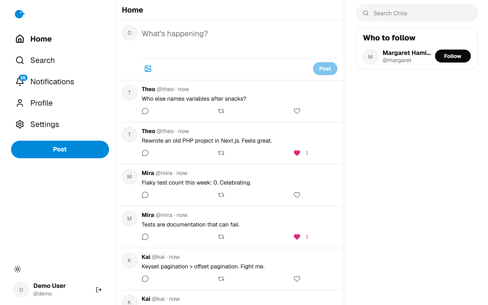
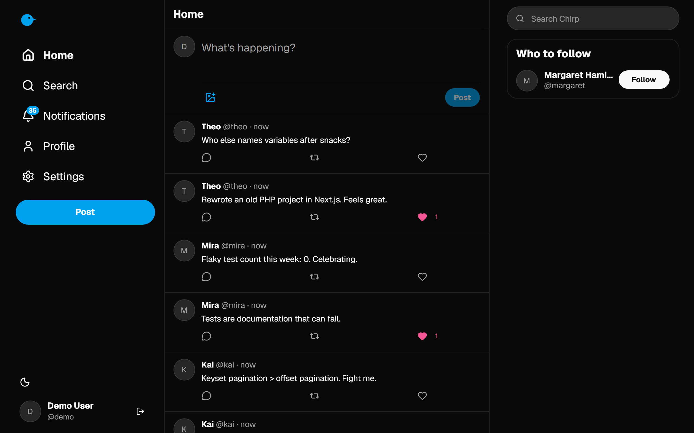
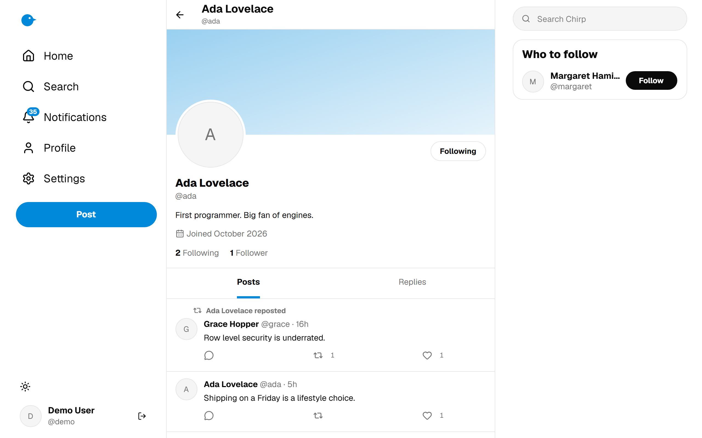
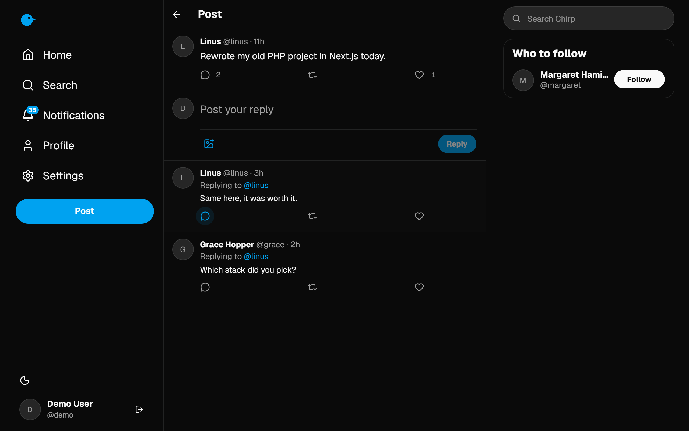
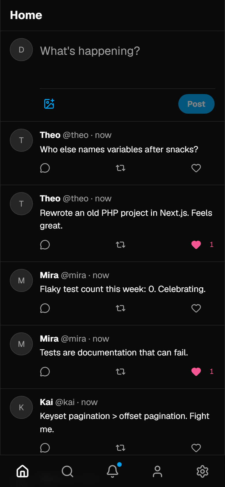
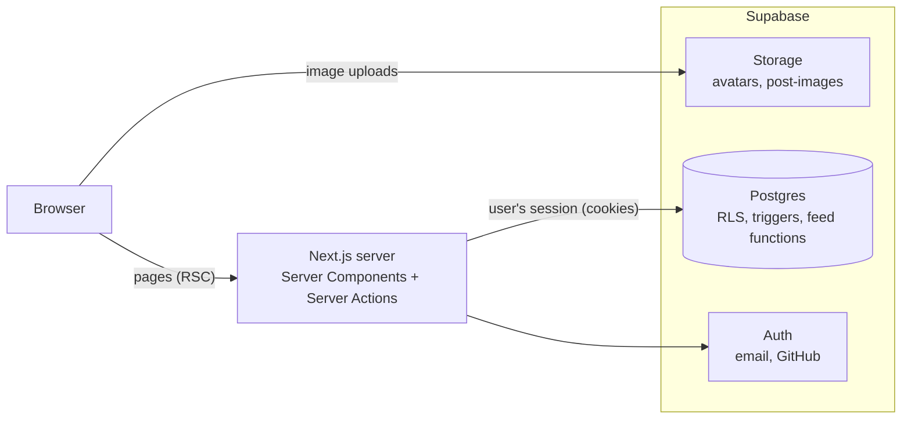

# Chirp

A small Twitter-style social app built with **Next.js 15** and **Supabase**. Post (with images), reply, like, repost, follow people, search, get notifications, edit your profile, in light or dark mode, on desktop or phone.

It started as a rewrite of an old PHP/MySQL class project. The goal was to rebuild it the way I would build it today: typed end to end, with authorization enforced by the database and tests where the logic lives.

**Live demo:** https://chirp-ochre-one.vercel.app (use the **Try the demo** button, no sign-up needed)

| Home (light) | Home (dark) |
|---|---|
|  |  |

| Profile | Post and replies | Mobile |
|---|---|---|
|  |  |  |

## Features

- Email + password and GitHub sign-in, plus a one-click demo account
- Posts up to 280 characters with an optional image (JPEG, PNG, WebP, GIF up to 5 MB)
- Replies with threaded post pages, likes and reposts with instant (optimistic) UI
- Follow / unfollow, follower and following lists, "who to follow" suggestions
- Home feed of your posts, people you follow and their reposts, with "Load more" pagination
- Search for people and posts
- Notifications for follows, likes, reposts and replies, with an unread badge
- Profile editing: name, username, bio and avatar
- Responsive three-column layout, light and dark themes

## How it works



- **Reads** happen in Server Components using the signed-in user's session, so every query runs under that user's permissions.
- **Writes** are Server Actions: input is validated with Zod, then written through Supabase. Actions return a typed `ActionResult` instead of throwing.
- **The database enforces the rules.** Row Level Security decides who can read and write each row. Triggers keep like/repost/reply counters and create notifications. SQL functions build the home feed, profile timelines, threads and search results. The UI can't bypass any of this.
- **Feed pagination** is keyset-based on `(activity_at, item_key)`, so posts with identical timestamps are never skipped or duplicated.
- **Images** are uploaded straight from the browser into a folder named after the user's id. Storage policies reject anything outside that folder.

Project layout:

```
supabase/migrations/   schema, RLS, triggers, feed/search functions, storage
supabase/tests/        pgTAP database tests
supabase/seed.sql      local demo data
src/app/               routes (App Router)
src/components/        UI (shadcn/ui based)
src/lib/actions/       Server Actions
src/lib/queries/       data loading for Server Components
src/lib/validation/    Zod schemas shared by forms and actions
e2e/                   Playwright tests
scripts/seed-demo.ts   creates the demo account in a real project
```

## Running it locally

Requirements: Node 22+, Docker (for the local Supabase stack).

```bash
npm ci
npx supabase start          # starts Postgres, Auth and Storage in Docker, applies migrations and seed data
npx supabase status -o env  # shows the local API URL and keys
```

Copy `.env.example` to `.env.local` and fill in `NEXT_PUBLIC_SUPABASE_URL` (`API_URL`) and `NEXT_PUBLIC_SUPABASE_PUBLISHABLE_KEY` (`PUBLISHABLE_KEY`, or `ANON_KEY` on older CLIs). For the demo button locally, use `DEMO_EMAIL=demo@chirp.local` and `DEMO_PASSWORD=password123`.

```bash
npm run dev
```

Open http://localhost:3000. Every seeded account (`demo`, `ada`, `linus`, `grace`, `margaret` at `@chirp.local`) uses the password `password123`.

## Tests

```bash
npm run lint
npm run typecheck
npm test            # Vitest: validation and utilities
npm run test:db     # pgTAP: schema, RLS, triggers, feed, search, storage (needs `supabase start`)
npm run test:e2e    # Playwright: sign up and post, follow/like/repost notifications, replies
```

`.github/workflows/ci.yml` runs all of these in GitHub Actions on every push.

## Deploying

1. Create a Supabase project, then link and push the schema:
   ```bash
   npx supabase link --project-ref <project-ref>
   npx supabase db push
   ```
2. In the Supabase dashboard under **Authentication → URL Configuration**, set the site URL to your Vercel URL and add `https://<your-app>.vercel.app/**` as a redirect URL. Under **Authentication → Emails → Confirm signup**, replace the template with `supabase/templates/confirmation.html` so confirmation links go to `/auth/confirm` and work in any browser.
3. For GitHub sign-in, create a GitHub OAuth App (**Settings → Developer settings → OAuth Apps**) with the callback URL `https://<project-ref>.supabase.co/auth/v1/callback`, then enable the GitHub provider in Supabase with its client id and secret.
4. Create a Vercel project from this repository and set `NEXT_PUBLIC_SUPABASE_URL`, `NEXT_PUBLIC_SUPABASE_PUBLISHABLE_KEY`, `NEXT_PUBLIC_SITE_URL`, `DEMO_EMAIL` and `DEMO_PASSWORD`. Use the project's production domain (e.g. `chirp-xxxx.vercel.app`) as the site URL, not the longer team alias. New projects have **Vercel Authentication** turned on, which puts a Vercel login in front of every `*.vercel.app` address; turn it off under **Settings → Deployment Protection** so visitors can reach the site.
5. Create the demo account from your machine (the service role key never goes to Vercel):
   ```bash
   SUPABASE_URL=https://<project-ref>.supabase.co SUPABASE_SERVICE_ROLE_KEY=... \
   DEMO_EMAIL=... DEMO_PASSWORD=... npx tsx scripts/seed-demo.ts
   ```
   The demo account is flagged `is_demo`, so the database refuses changes to its email, password and username, even from a demo session. Running the script again resets its password and profile if a visitor changed the name, bio or avatar.

## What changed from the PHP version

The original app (2023) was a handful of PHP pages talking to MySQL. The rewrite keeps the idea and fixes the foundations:

- Plain-text passwords → Supabase Auth (hashed).
- SQL injection in login and registration → parameterized queries through the Supabase client, plus RLS.
- Tweets created via GET requests (CSRF) → Server Actions (POST, origin-checked by Next.js).
- Swapped followers/following counts fixed; usernames are unique; unfollow added; self-follow blocked.
- Stored procedures → RLS-protected queries and a few SQL functions.
- New: likes, reposts, replies, images, notifications, profile editing, search, a responsive UI and automated tests.
